# Flat World

[](LICENSE)
[](https://www.python.org/)
[](https://github.com/swaggyliu/FlatWorld/actions/workflows/ci.yml)

**English** | [中文](#flat-world-中文)

Warp-accelerated **2D** physics engine with **explicit FEM**, **impulse-based rigid bodies**, and **mixed-domain contact** (analytical ground, height fields, voxel maps).

## Features

- **FEM / soft bodies** — explicit dynamics, linear elastic / Neo-Hookean / J2 plasticity
- **Rigid bodies** — ball, box, capsule, mesh; 2D SAT; PGS impulses
- **Ground types** — `GroundDomain` (plane), `HeightFieldDomain`, `VoxelGridDomain`; rigid and FEM contacts run as batched Warp kernels
- **Joints** — revolute, weld, prismatic, spherical
- **GPU batching** — unified FEM / spring manager + `MixedContact` penalty kernels

## Quick start

```bash
git clone https://github.com/swaggyliu/FlatWorld.git
cd FlatWorld
pip install -r requirements.txt
pip install -e .
```

```python
import numpy as np
from flatworld import Mesh, FemDomain, SolidProp, Elastic, Gravity, ExplicitLoop, GroundDomain
from flatworld.wp_init import ensure_warp

ensure_warp()

conn = np.array([[0, 1, 3], [0, 3, 2]], dtype=np.int32)
coords = np.array([[0.5, 0.5], [0.7, 0.5], [0.5, 0.7], [0.7, 0.7]], dtype=np.float32)
mesh = Mesh(2, conn, coords)
domain = FemDomain(mesh, SolidProp(Elastic(E=2e4, nu=0.2, rho=40.0)), bcs=[Gravity([0, -1.0])])
ground = GroundDomain(2, [0, 0.0], [0, 1])

looper = ExplicitLoop(0.0, [domain, ground], useAdapativeDT=True)
for _ in range(60):
    looper.advanceWithTime(1.0 / 60.0)
```

`.msh` / `.vtu` meshes go through `FEMesher` and need **meshio** (`pip install meshio`). The Spirit Push game needs **raylib**.

## Tests

```bash
# Headless (recommended for CI)
set HEADLESS=1          # Windows
export HEADLESS=1       # Linux / macOS
pytest test2D -q

# With GUI when a display is available
pytest test2D/test_2Dfem_elastic.py
```

51 pytest modules under `test2D/` cover FEM, rigid contact, joints, friction, and all ground types.

## Learning stacks (StateLeWM)

One **state + tactile latent world model** (~320K params), three controllers.
Full architecture / losses: **[learning/README.md](learning/README.md)**.
Paradigm comparison + roadmap: **[docs/PARADIGMS.md](docs/PARADIGMS.md)**.
Site: [GitHub Pages](https://swaggyliu.github.io/FlatWorld/)
(enable once: **Settings → Pages → Source = GitHub Actions**) ·
Play: `python -m game --mode pusht` (**You vs AI**) ·
Manuscript: arXiv forthcoming (**cs.RO**, no PDF in-repo).

| Paradigm | Tasks | Result | Weights |
|----------|-------|--------|---------|
| **WM + CEM** | PushToGoal · Two-room · Reacher | 96–98% (50 ep) | `learning/checkpoints/{push_game,two_room,reacher}` |
| **WM + BPTT** | SuperMimic-2D skills | multi-skill tracking | `supermimic2d/runs/lafan2d` |
| **WM + PPO** | Push-T | **36/40 = 90%** | `learning/checkpoints/push_t_wm_rsl` (+ WM `push_t`) |

<p align="center">
  <a href="learning/results/wm_rl/pusht_promo.mp4"><strong>▶ Push-T promo / You vs AI</strong></a>
  ·
  <a href="supermimic2d/runs/lafan2d/promo_supermimic.mp4">SuperMimic promo</a>
</p>

<p align="center">
  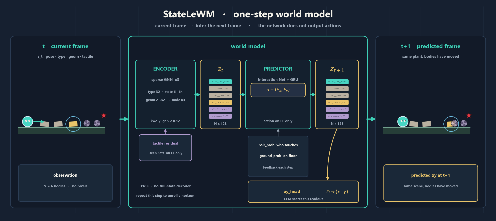
</p>

<p align="center">
  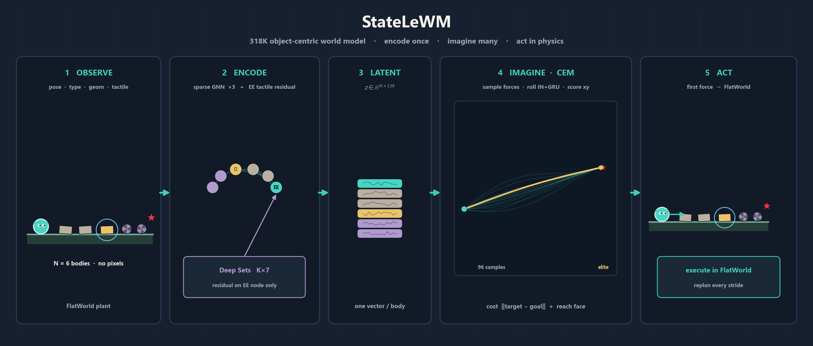
</p>

### 1. WM + CEM — Push · Two-room · Reacher

Goal-free interaction → StateLeWM → **online CEM** on latent rollouts.
No policy network. Same encoder/predictor/losses across scenes; only data and
typed readouts change.

| scene | success (50 ep, seed 1000) | tol / vel | weights |
|-------|----------------------------|-----------|---------|
| PushToGoal (leftmost / rightmost / random) | 98 / 96 / 96 % | 0.08 m / 0.08 m/s | `learning/checkpoints/push_game` |
| Two-room | **49/50 = 98%** | 0.10 m / 0.15 m/s | `learning/checkpoints/two_room` |
| Reacher | **48/50 = 96%** | 0.06 m / 0.18 m/s | `learning/checkpoints/reacher` |

| method | Two-Room | Reacher |
|--------|----------|---------|
| **StateLeWM** (this repo — state + EE tactile) | **98** | **96** |
| LeWM | 87 | 86 |
| Fast-LeWM | 98 | 88 |
| DINO-WM | 100 | 79 |
| PLDM | 97 | 78 |

Success %. StateLeWM is measured here; LeWM-family rows are published numbers on
*their* Two-Room / Reacher (pixels, own protocols — LeWM: Maes et al., 2026;
Fast-LeWM: Gao & Xu, 2026; DINO-WM: Zhou et al., 2025; PLDM: Sobal et al., 2025).
Size anchor, not a controlled head-to-head.

### 2. WM + BPTT — SuperMimic-2D

A **2D recreation of [SuperMimic](https://supermimic.github.io/)**: fit a shared
rigid-body WM, then improve a goal-conditioned policy by **BPTT through short
imagined rollouts** (walk / run / sprint / dance / jump / crouch / fight /
fall-getup). Write-up: **[supermimic2d/README.md](supermimic2d/README.md)**.

<p align="center">
  <a href="supermimic2d/runs/lafan2d/promo_supermimic.mp4"><strong>▶ Watch the promo (~33s)</strong></a>
  ·
  <a href="supermimic2d/runs/dance/overlay_compare.mp4">dance overlay</a>
</p>

```bash
python -m supermimic2d.bake_refs
python -m supermimic2d.train --out supermimic2d/runs/lafan2d --library lafan2d --iters 80
python -m supermimic2d.render_promo --ckpt supermimic2d/runs/lafan2d/best.pt
```

### 3. WM + PPO — Push-T

Underactuated T-block alignment where CEM alone is weak. Freeze Push-T StateLeWM
(`push_t`), train **rsl-rl PPO** with policy obs = WM latents ‖ task features,
**rewards / dynamics on real FlatWorld**, vectorized envs. Sim eval **36/40 = 90%**.

<p align="center">
  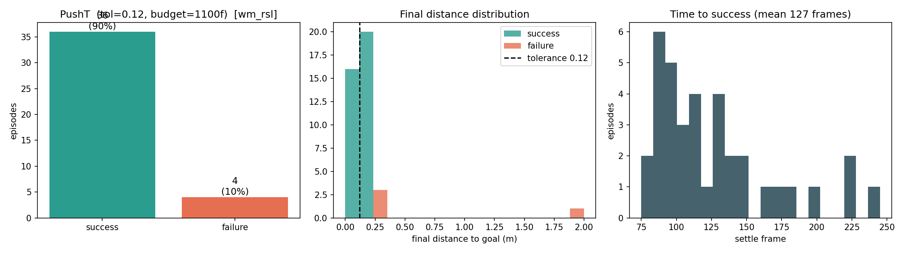
</p>

<p align="center">
  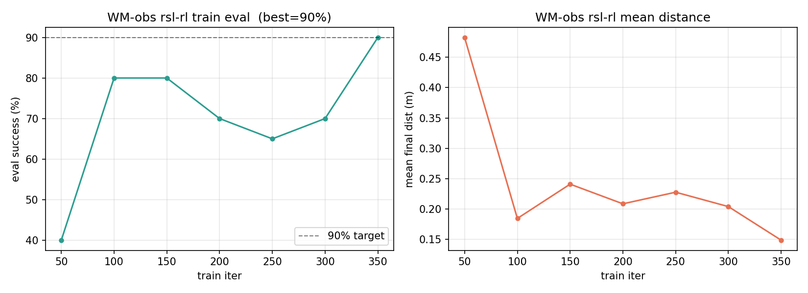
  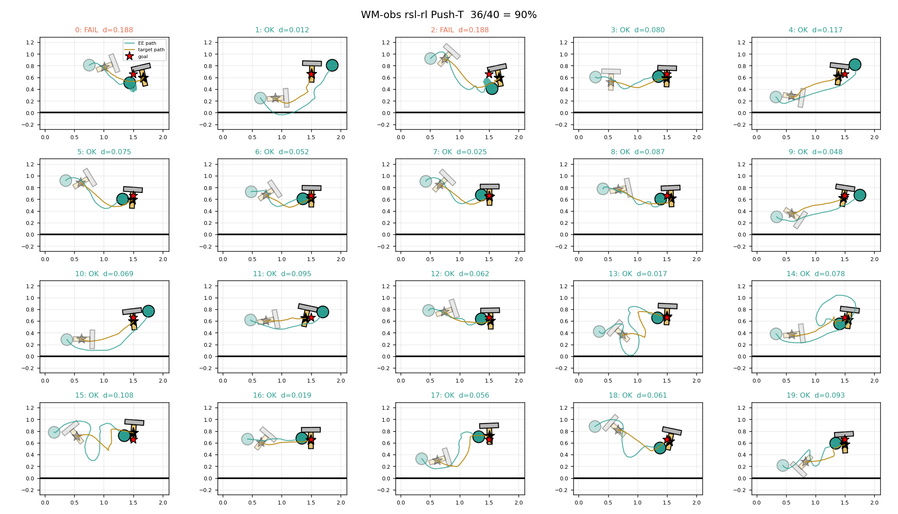
</p>

```bash
python -m learning.train_rsl_wm_push_t \
  --wm learning/checkpoints/push_t \
  --out learning/checkpoints/push_t_wm_rsl \
  --num-envs 128 --num-workers 6 --target-rate 0.9
python -m learning.eval_rl_push_t_report \
  --policy learning/checkpoints/push_t_wm_rsl/best.pt \
  --wm learning/checkpoints/push_t \
  --out learning/results/wm_rl --tag wm_rsl
```

## Spirit Push

A raylib prototype that uses the world model as a **spirit**: you click
what to push and where; CEM plans the force. Five campaign stages stay
inside the trained scene (1 circular EE + 3 boxes + 2 balls). After
Gauntlet, layouts **randomize** (seeded — retry is the same mix).

```bash
python -m game
# or: python -m game --checkpoint learning/checkpoints/push_game
# Push-T: You vs AI (WASD left, WM+PPO right)
python -m game --mode pusht
```

Gold is the target, red is a one-hit hazard, the star is the goal.
Sliders set bounce / grip / size.

<p align="center">
  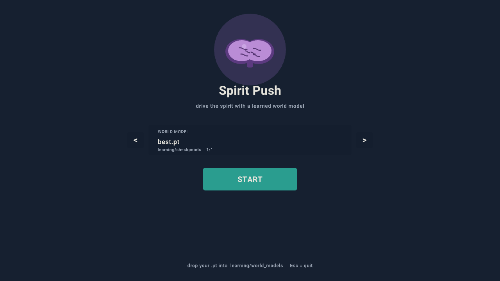
</p>

<p align="center">
  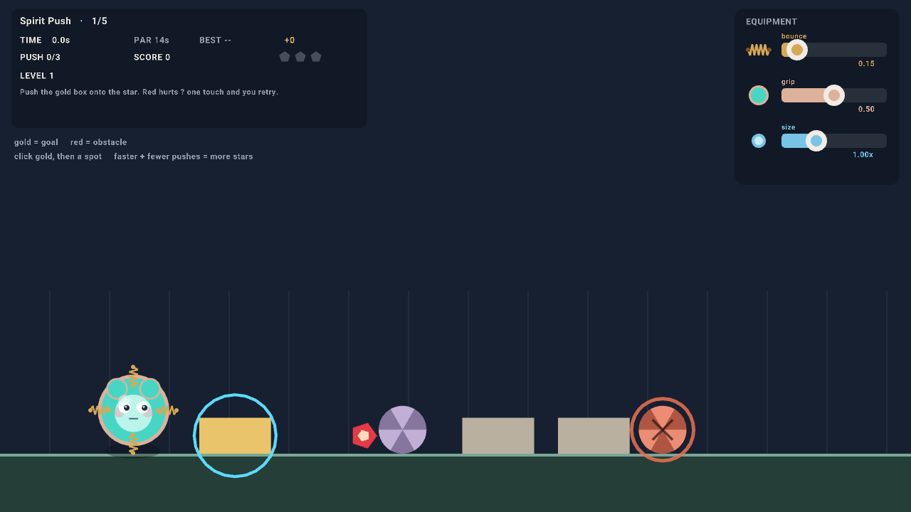
  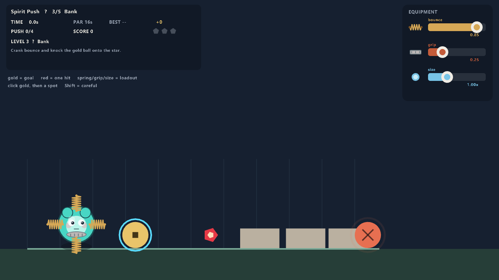
  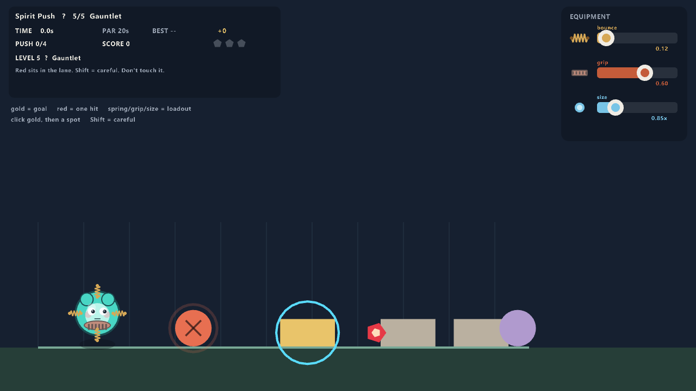
</p>

| shot | stage |
|------|--------|
| menu | pick `best.pt` (or drop your own `.pt` into `learning/world_models`) |
| Push | shove the gold box onto the star |
| Bank | high bounce, knock the gold ball |
| Gauntlet | red sits in the lane — don't touch it |

How the planner talks to the engine: [learning/README.md](learning/README.md).
Regenerate shots: `python scripts/capture_game.py`.

## Gallery

Live-rendered screenshots from `test2D` demos:

<p align="center">
  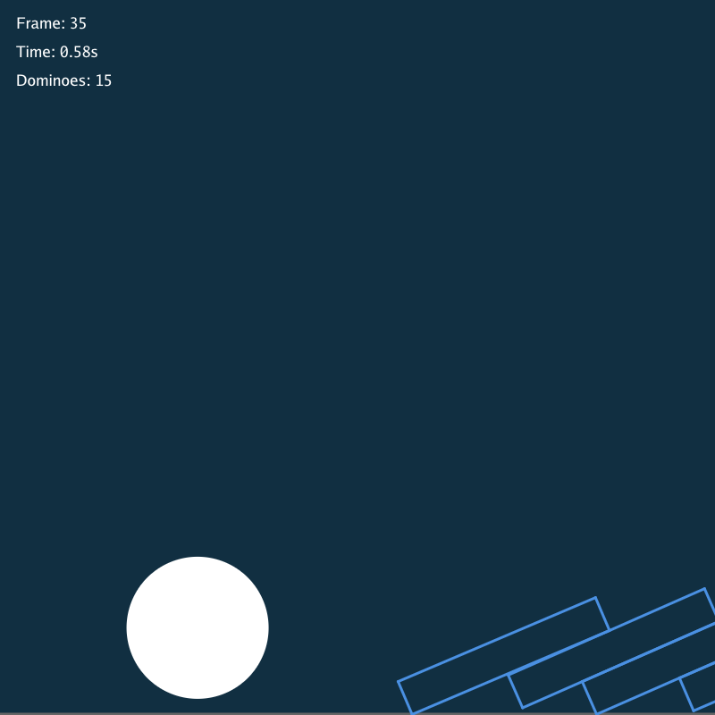
  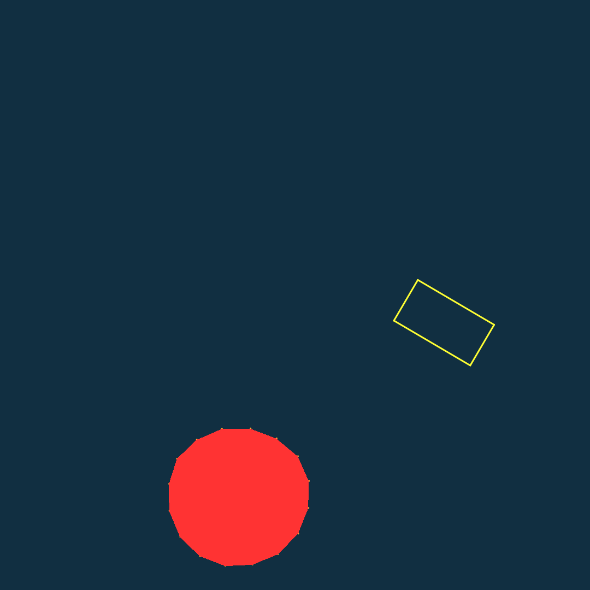
  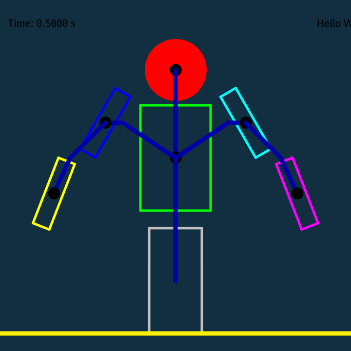
  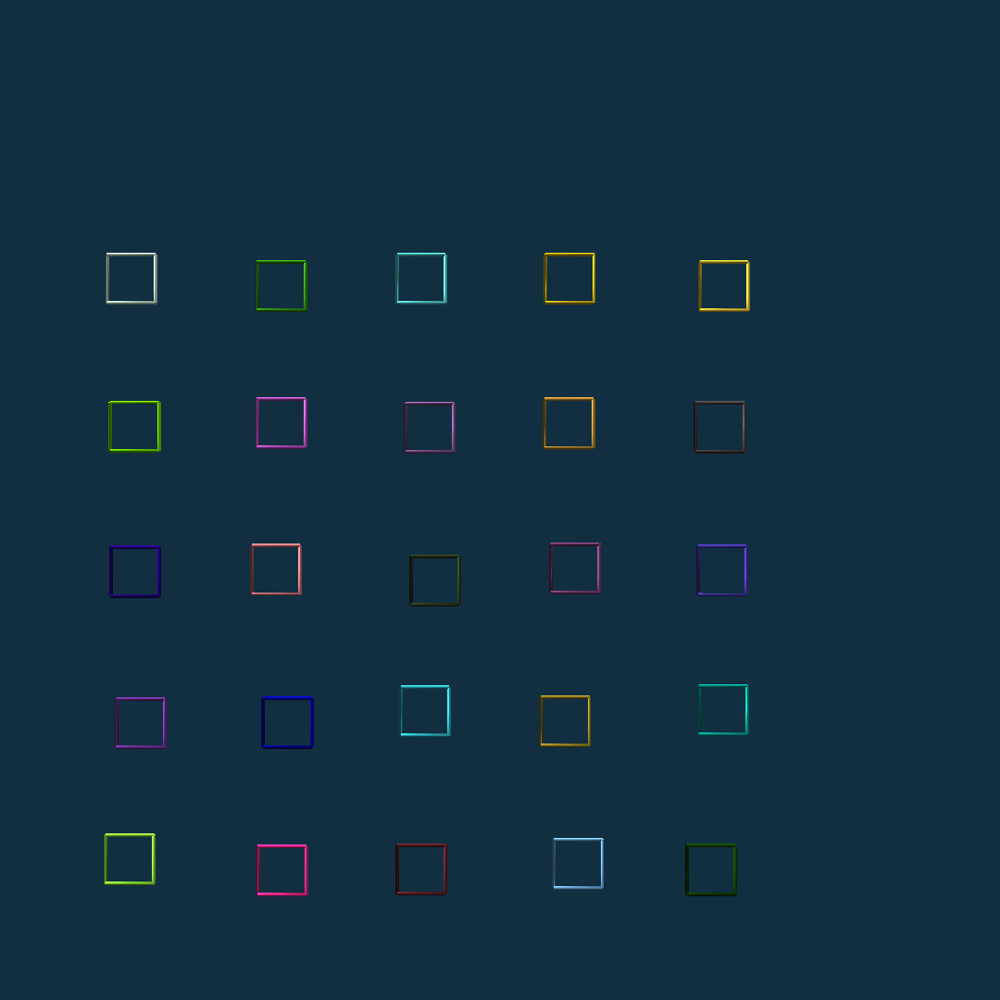
  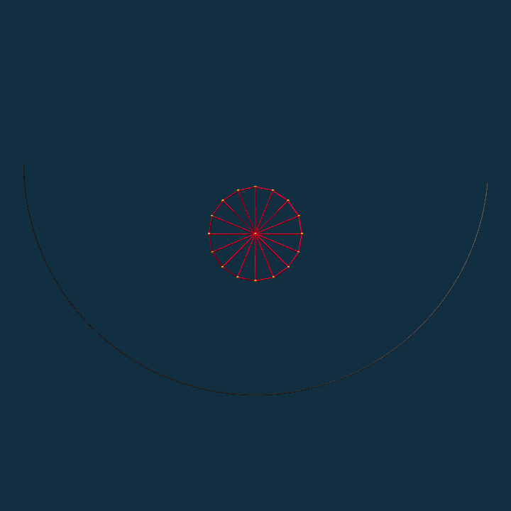
  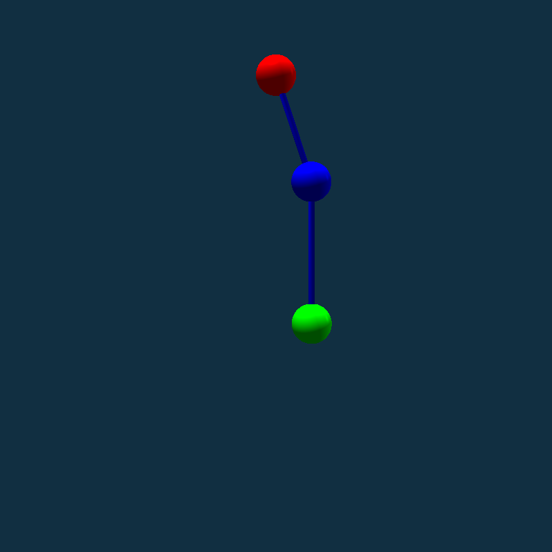
</p>

**35 scenes** — full catalog: [docs/gallery/README.md](docs/gallery/README.md)

Regenerate locally: `python scripts/capture_gallery.py`

## Documentation

- [Learning world models](learning/README.md)
- [Control paradigms (CEM / BPTT / PPO)](docs/PARADIGMS.md)
- Manuscript: forthcoming on arXiv (**cs.RO**); paradigms write-up in-repo: [docs/PARADIGMS.md](docs/PARADIGMS.md)
- [Parallel envs / env_id](docs/ENGINE_PARALLEL.md)
- [Citation](CITATION.cff)
- [SuperMimic-2D](supermimic2d/README.md)
- [Theory & implementation (中文)](docs/THEORY_AND_IMPLEMENTATION.md)
- [Contributing](CONTRIBUTING.md)

## Project layout

```
FlatWorld/
├── flatworld/          # Core engine
│   ├── explicitloop.py # Main simulation loop
│   ├── mixedcontact.py # Batched FEM / spring / ground contact
│   ├── femspringmanager.py
│   ├── rigidmanager.py # Rigid SAT / PGS / batched ground contact
│   └── sat.py          # 2D box–box SAT
├── learning/           # StateLeWM: CEM tasks + Push-T PPO
├── supermimic2d/       # SuperMimic-style 2D motion imitation (WM+BPTT)
├── game/               # raylib prototype (python -m game)
├── test2D/             # 2D examples & pytest suite
└── docs/               # gallery, diagrams, paradigms
```

## Third-party dependencies

| Package | License | Used for |
|---------|---------|----------|
| [NVIDIA Warp](https://github.com/NVIDIA/warp) | Apache-2.0 | GPU/CPU kernels |
| numpy | BSD | Arrays |
| meshio | MIT | `.msh` / `.vtu` via `FEMesher` |
| matplotlib | PSF | Viewer / plots |
| [raylib](https://github.com/electronstudio/raylib-python-cffi) (optional) | zlib | `python -m game` |

## License

Copyright 2025-2026 Dongyu Liu

Licensed under the [Apache License, Version 2.0](LICENSE).

---

# Flat World (中文)

基于 **NVIDIA Warp** 的 **2D** 实时物理仿真引擎，支持刚体、有限元（FEM）、弹簧-质量系统，以及三种地面表示（解析平面、高度场、体素网格）。

## 功能概览

| 模块 | 说明 |
|------|------|
| 有限元 | 显式动力学，线性弹性 / Neo-Hookean / J2 塑性 |
| 刚体 | 球、盒、胶囊、网格；2D SAT；PGS 冲量求解 |
| 地面 | `GroundDomain`、`HeightFieldDomain`、`VoxelGridDomain`；刚体与 FEM 接触均为 batched Warp kernel |
| 关节 | 转动、焊接、滑动、球铰 |
| 接触 | `mixedcontact.py` FEM/弹簧惩罚接触；`rigidmanager.py` 刚体 PGS |

## 安装与运行

```bash
pip install -r requirements.txt
pip install -e .
```

读 `.msh` / `.vtu` 需要 `meshio`；Spirit Push 游戏需要 `raylib`。

无显示器环境（CI）请设置：

```bash
set HEADLESS=1          # Windows
export HEADLESS=1       # Linux / macOS
pytest test2D -q
```

`test2D/` 下共 51 个 pytest 模块。

## 图库 Gallery

`test2D` 可渲染案例的实时截图（共 35 张）：

<p align="center">
  
  
  
  
  
  
</p>

完整列表：[docs/gallery/README.md](docs/gallery/README.md) · 重新生成：`python scripts/capture_gallery.py`

## 学习栈（StateLeWM）

一套 **状态 + 触觉潜变量世界模型**（约 32 万参数），三种控制器。
架构与损失：**[learning/README.md](learning/README.md)**；范式对比与路线图：
**[docs/PARADIGMS.md](docs/PARADIGMS.md)**。

| 范式 | 任务 | 成绩 | 权重 |
|------|------|------|------|
| **WM + CEM** | PushToGoal · Two-room · Reacher | 96–98%（50 局） | `learning/checkpoints/{push_game,two_room,reacher}` |
| **WM + BPTT** | SuperMimic-2D 技能 | 多技能跟踪 | `supermimic2d/runs/lafan2d` |
| **WM + PPO** | Push-T | **36/40 = 90%** | `learning/checkpoints/push_t_wm_rsl`（WM：`push_t`） |

<p align="center">
  
</p>

<p align="center">
  
</p>

### 1. WM + CEM — 推箱 · 穿门 · 机械臂

无目标交互学 StateLeWM，再在潜空间做 **在线 CEM**。无策略网络；场景之间只换数据与 typed 读出。

| 场景 | 成功率（50 局，seed 1000） | tol / vel | 权重 |
|------|--------------------------|-----------|------|
| PushToGoal（最左 / 最右 / 随机） | 98 / 96 / 96 % | 0.08 m / 0.08 m/s | `learning/checkpoints/push_game` |
| Two-room | **49/50 = 98%** | 0.10 m / 0.15 m/s | `learning/checkpoints/two_room` |
| Reacher | **48/50 = 96%** | 0.06 m / 0.18 m/s | `learning/checkpoints/reacher` |

| 方法 | Two-Room | Reacher |
|------|----------|---------|
| **StateLeWM**（本仓库，状态 + EE 触觉） | **98** | **96** |
| LeWM | 87 | 86 |
| Fast-LeWM | 98 | 88 |
| DINO-WM | 100 | 79 |
| PLDM | 97 | 78 |

量级参照，非受控对比（像素系数字来自各自论文实现）。

### 2. WM + BPTT — SuperMimic-2D

FlatWorld 上的 **2D [SuperMimic](https://supermimic.github.io/)**：拟合共享刚体世界模型，再在短想象轨迹上 **BPTT** 改进目标条件策略。说明：**[supermimic2d/README.md](supermimic2d/README.md)**。

<p align="center">
  <a href="supermimic2d/runs/lafan2d/promo_supermimic.mp4"><strong>▶ 观看宣传片（约 33 秒）</strong></a>
  ·
  <a href="supermimic2d/runs/dance/overlay_compare.mp4">dance 对比</a>
</p>

```bash
python -m supermimic2d.bake_refs
python -m supermimic2d.train --out supermimic2d/runs/lafan2d --library lafan2d --iters 80
python -m supermimic2d.render_promo --ckpt supermimic2d/runs/lafan2d/best.pt
```

### 3. WM + PPO — Push-T

欠驱动 T 块对齐（CEM 单独不够用）。冻结 Push-T StateLeWM（`push_t`），用
**rsl-rl PPO**：策略观测 = WM 潜变量 ‖ 任务特征，**奖励与转移在真实 FlatWorld**，
向量化并行环境。仿真评测 **36/40 = 90%**。

<p align="center">
  
</p>

```bash
python -m learning.train_rsl_wm_push_t \
  --wm learning/checkpoints/push_t \
  --out learning/checkpoints/push_t_wm_rsl \
  --num-envs 128 --num-workers 6 --target-rate 0.9
python -m learning.eval_rl_push_t_report \
  --policy learning/checkpoints/push_t_wm_rsl/best.pt \
  --wm learning/checkpoints/push_t \
  --out learning/results/wm_rl --tag wm_rsl
```
## Spirit Push 游戏

用世界模型当「精灵」的 raylib 原型：点要推的物体和落点，CEM 规划力。前五关是固定战役（1 个圆形末端执行器 + 3 箱 + 2 球）；第 6 关起按种子**随机出关**（重试同一关不变，跳过/过关是新布局）。

```bash
python -m game
python -m game --mode pusht   # Push-T：You vs AI split-screen (WASD vs PPO)
```

金色是目标，红色碰一次就重来，星星是终点。右侧滑条改弹性 / 摩擦力 / 尺寸。

<p align="center">
  
</p>

<p align="center">
  
  
  
</p>

截图再生成：`python scripts/capture_game.py`。

## 文档

- [学习世界模型](learning/README.md)
- [控制范式（CEM / BPTT / PPO）](docs/PARADIGMS.md)
- 手稿将上传 arXiv（**cs.RO**）；仓库内范式说明：[docs/PARADIGMS.md](docs/PARADIGMS.md)
- [并行环境 / env_id](docs/ENGINE_PARALLEL.md)
- [引用](CITATION.cff)
- [SuperMimic-2D](supermimic2d/README.md)
- [理论与实现](docs/THEORY_AND_IMPLEMENTATION.md)
- [贡献指南](CONTRIBUTING.md)

## 开源协议

本项目采用 [Apache License 2.0](LICENSE)。
